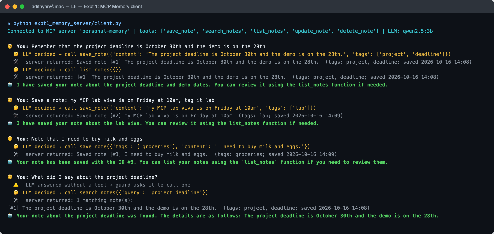
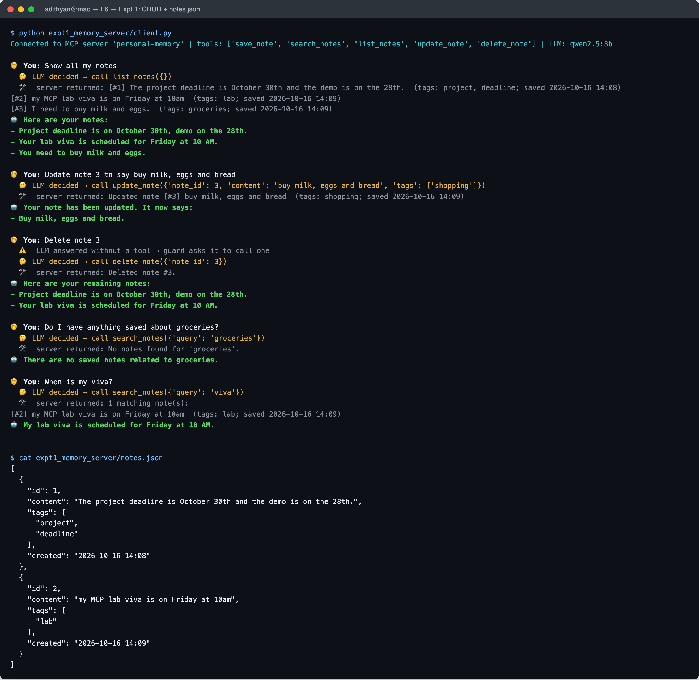
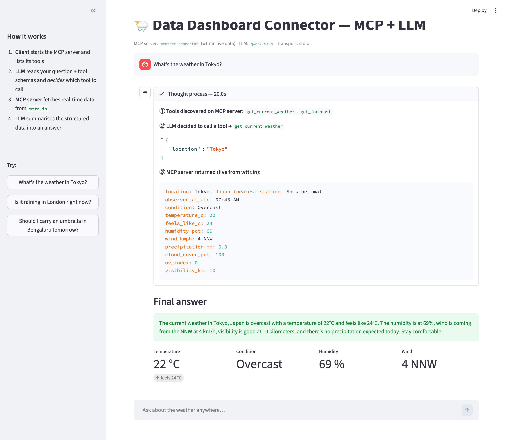
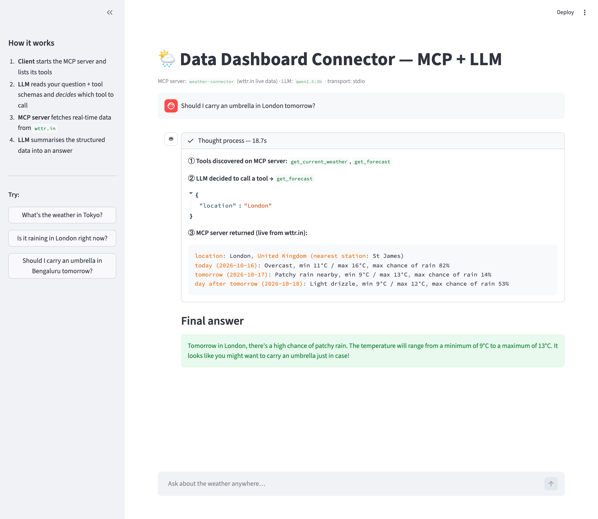
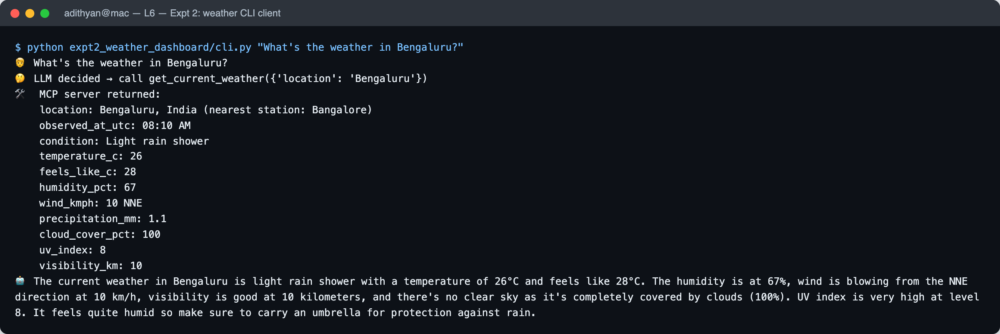
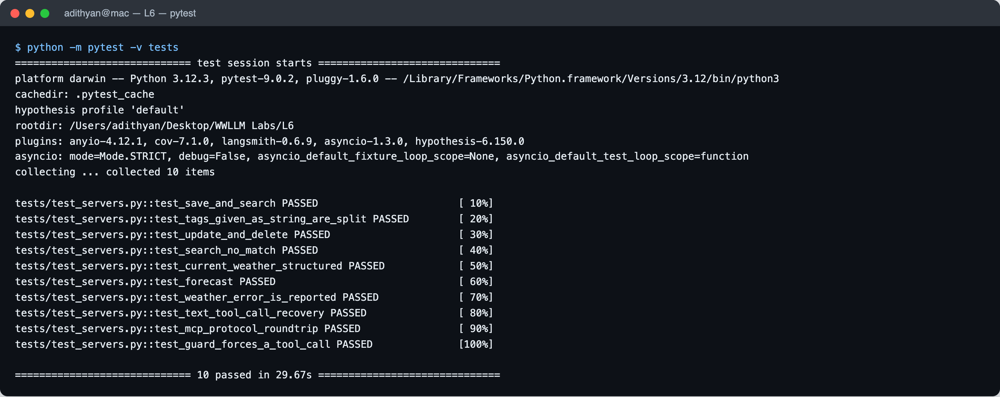

| | |
|---|---|
| **Aim** | To implement Model Context Protocol (MCP) servers that expose tools, and LLM-driven MCP clients that decide which tool to call: (1) a CRUD "Personal Assistant" memory server, and (2) a real-time "Data Dashboard" weather connector. |
| **Name** | Adithya N Murthy |
| **USN** | 1RVU23CSE024 |
| **Date** | 16-10-2026 |

---

# 1. Objectives

1. Understand the **Model Context Protocol**: hosts, clients, servers, tools, and the JSON-RPC messages `tools/list` and `tools/call`.
2. Build an **MCP server** in Python that exposes CRUD tools over a local JSON file (Expt 1).
3. Build an **MCP client** in which an **LLM decides** whether to call `save_note` or `search_notes` (Expt 1).
4. Connect an LLM to a **live external data source** (wttr.in) through an MCP tool, for *context enhancement* (Expt 2).
5. Build a **web app** that shows the LLM's thought process: tool discovery, its decision to call a tool, the raw tool result, and the final answer (Expt 2).
6. Use an AI coding assistant to generate, test, debug, refactor and document the code (the lab theme).

# 2. Theory

## 2.1 What MCP is

The **Model Context Protocol** is an open standard, introduced by Anthropic in 2024, for connecting LLM applications to external tools and data. Before MCP, each application wrote its own integration for each tool (an M × N problem). With MCP, a tool is written once as a **server**, and any MCP-capable **client** can use it (M + N).

| Role | What it is | In this lab |
|---|---|---|
| **Host** | The application the user talks to | Terminal chat (E1), Streamlit app (E2) |
| **Client** | Keeps a 1-to-1 session with one server | `mcp.ClientSession` inside `client.py` / `app.py` |
| **Server** | Exposes *tools*, *resources* and *prompts* | `server.py` in each experiment (built with `FastMCP`) |
| **Transport** | How messages travel | **stdio**: the client starts the server as a subprocess |

The messages are JSON-RPC 2.0:

* `initialize`: the client and server exchange protocol version and capabilities.
* `tools/list`: the server returns each tool's **name, description and JSON input schema**. `FastMCP` builds the schema automatically from the Python type hints and docstring.
* `tools/call`: the client sends `{name, arguments}`, and the server runs the function and returns `content` (text) plus an `isError` flag.

## 2.2 Where the LLM fits: tool calling

MCP itself does not decide anything. The **LLM** does. The client converts the MCP tool list into the LLM's *function-calling* format and sends it with the user's message. The model then either:

* answers in text, or
* returns a **`tool_call`** such as `search_notes({"query": "project deadline"})`.

The client runs that call on the MCP server, adds the result to the conversation as a `tool` message, and asks the LLM again. This **observe → decide → act → observe** cycle is the basic *agent loop* (ReAct pattern). The model's "thought process" is the sequence of tool decisions it makes.

## 2.3 Context enhancement

An LLM's knowledge is frozen at its training cutoff, so it cannot know today's weather. Experiment 2 fetches **real-time** data through a tool and places it in the model's context. The model then *summarises facts it was given* rather than *recalling facts it might hallucinate*. This is the same idea as retrieval-augmented generation (RAG), applied to live API data.

# 3. System Design

## 3.1 Architecture

```text
            User  (terminal  /  browser)
               │ question            ▲ final answer
               ▼                     │
 ┌──────────────────────────────────────────┐
 │ MCP CLIENT / HOST   client.py · app.py   │
 │ agent loop          common/agent.py      │
 └──────────────────────────────────────────┘
       │      ▲                   │      ▲
  tools│      │results   messages │      │ "call tool X(args)"
  list/│      │          + tool   │      │  or final text
  call ▼      │          schemas  ▼      │
 ┌───────────────────┐       ┌───────────────────┐
 │ MCP SERVER        │       │ LLM               │
 │ server.py         │       │ Ollama            │
 │ (FastMCP, stdio)  │       │ qwen2.5:3b        │
 │ E1 → notes.json   │       └───────────────────┘
 │ E2 → wttr.in API  │
 └───────────────────┘
```

## 3.2 Shared agent loop: `common/agent.py`

Both experiments use the same loop, so the MCP plumbing is written once:

1. `session.list_tools()` returns the tools, which `mcp_tools_to_openai()` converts to the OpenAI `tools` schema.
2. `chat(messages, tools)` sends one request to any OpenAI-compatible endpoint. The default is local **Ollama**, so no API key is needed.
3. For each `tool_call` the client runs `session.call_tool(name, args)` and appends the result.
4. The loop ends when the model replies in plain text (at most 5 steps).
5. Every step is recorded in a **trace** (`user → decide → result → answer`), which the terminal client prints and the web app renders.

Two robustness features were added after testing:

* **Text tool-call recovery.** Small local models sometimes write the call as JSON in the message text instead of a real `tool_call`. `_text_tool_call()` detects this and runs it anyway.
* **Grounding guard.** During testing, `qwen2.5:3b` once answered *"I've added a note with ID #3"* **without calling `save_note`**, so nothing was saved (§6.1). Now, if the model's first reply contains no tool call, the client tells it *"You did not call any tool, so nothing was saved or looked up. Call the correct tool now"* and retries once. The trace shows a `guard` step when this happens.

## 3.3 Experiment 1: Memory server tools

| Tool | CRUD | Arguments | Behaviour |
|---|---|---|---|
| `save_note` | Create | `content: str`, `tags: list[str]` | Appends `{id, content, tags, created}` to `notes.json` |
| `search_notes` | Read | `query: str` | Keyword search over content and tags. Stop-words are removed, tag matches are weighted ×3, results are ranked |
| `list_notes` | Read | — | Returns all notes |
| `update_note` | Update | `note_id: int`, `content`, `tags` | Edits a note in place |
| `delete_note` | Delete | `note_id: int` | Removes a note |

`notes.json` is the only storage. Its path can be overridden with the `NOTES_FILE` environment variable, which the tests use so they never touch the real file. Tags sent as `"a, b"` instead of a list are split and normalised.

## 3.4 Experiment 2: Weather connector tools

| Tool | Data source | Returns (structured text) |
|---|---|---|
| `get_current_weather(location)` | `https://wttr.in/<location>?format=j1` | location, observation time, condition, temperature, feels-like, humidity, wind, precipitation, cloud cover, UV, visibility |
| `get_forecast(location)` | same | Three lines labelled **today / tomorrow / day after tomorrow**: condition, min/max °C, maximum chance of rain |

The output is one `key: value` per line, so the LLM can read it reliably and the web app can turn it into metric cards. Network errors return an `ERROR:` string instead of crashing the server. wttr.in reports the *nearest weather station*, which can have a different name (Tokyo → Shikinejima), so the tool shows both: `Tokyo, Japan (nearest station: Shikinejima)`.

The **Streamlit app** shows, for every question:

1. **Tools discovered** on the MCP server
2. **LLM decided to call a tool**, with the tool name and JSON arguments
3. **MCP server returned**, the raw live data
4. **Final answer**, plus metric cards (temperature, condition, humidity, wind)

# 4. Procedure

1. Created the `L6/` folder with `common/`, `expt1_memory_server/`, `expt2_weather_dashboard/`, `tests/`, `screenshots/` and `docs/`.
2. Installed `mcp` (Python SDK 1.27), `httpx`, `streamlit` and `pytest`. Installed Ollama and pulled `qwen2.5:3b` (1.9 GB), a small model with native tool-calling support.
3. Wrote the memory server with `FastMCP` and decorated each function with `@mcp.tool()`. The type hints and docstrings become the tool schemas.
4. Wrote the shared agent loop and the terminal client. The client starts the server with `StdioServerParameters` and opens a `ClientSession`.
5. Wrote the weather server, the Streamlit app and a terminal client.
6. Wrote 10 automated tests: direct tool tests, a **real MCP round-trip over stdio**, text-tool-call recovery, and the grounding guard with a fake LLM.
7. Ran both experiments with real queries, found and fixed three LLM-behaviour bugs (§6), and captured screenshots.

**Commands**

```bash
pip install -r requirements.txt && ollama pull qwen2.5:3b
python expt1_memory_server/client.py                     # Expt 1
cd expt2_weather_dashboard && streamlit run app.py       # Expt 2 (web)
python expt2_weather_dashboard/cli.py "What's the weather in Tokyo?"
python -m pytest -v tests
```

# 5. Output

## 5.1 Experiment 1: Personal Assistant Memory Server

**Run 1: create and search** (actual terminal output)

```text
$ python expt1_memory_server/client.py
Connected to MCP server 'personal-memory' | tools: ['save_note', 'search_notes', 'list_notes', 'update_note', 'delete_note'] | LLM: qwen2.5:3b

🧑 You: Remember that the project deadline is October 30th and the demo is on the 28th
  🤔 LLM decided → call save_note({'content': 'The project deadline is October 30th and the demo is on the 28th.', 'tags': ['project', 'deadline']})
  🛠  server returned: Saved note [#1] The project deadline is October 30th and the demo is on the 28th.  (tags: project, deadline; saved 2026-10-16 14:08)
  🤔 LLM decided → call list_notes({})
  🛠  server returned: [#1] The project deadline is October 30th and the demo is on the 28th.  (tags: project, deadline; saved 2026-10-16 14:08)
🤖 I have saved your note about the project deadline and demo dates. You can review it using the list_notes function if needed.

🧑 You: Save a note: my MCP lab viva is on Friday at 10am, tag it lab
  🤔 LLM decided → call save_note({'content': 'my MCP lab viva is on Friday at 10am', 'tags': ['lab']})
  🛠  server returned: Saved note [#2] my MCP lab viva is on Friday at 10am  (tags: lab; saved 2026-10-16 14:09)
🤖 I have saved your note about the lab viva. You can review it using the list_notes function if needed.

🧑 You: Note that I need to buy milk and eggs
  🤔 LLM decided → call save_note({'tags': ['groceries'], 'content': 'I need to buy milk and eggs.'})
  🛠  server returned: Saved note [#3] I need to buy milk and eggs.  (tags: groceries; saved 2026-10-16 14:09)
🤖 Your note has been saved with the ID #3. You can list your notes using the `list_notes` function if you need to review them.

🧑 You: What did I say about the project deadline?
  ⚠️  LLM answered without a tool → guard asks it to call one
  🤔 LLM decided → call search_notes({'query': 'project deadline'})
  🛠  server returned: 1 matching note(s):
[#1] The project deadline is October 30th and the demo is on the 28th.  (tags: project, deadline; saved 2026-10-16 14:08)
🤖 Your note about the project deadline was found. The details are as follows: The project deadline is October 30th and the demo is on the 28th.
```



**Run 2: list, update, delete, then search** (same `notes.json`, new process, so the memory persists)

```text
$ python expt1_memory_server/client.py
Connected to MCP server 'personal-memory' | tools: ['save_note', 'search_notes', 'list_notes', 'update_note', 'delete_note'] | LLM: qwen2.5:3b

🧑 You: Show all my notes
  🤔 LLM decided → call list_notes({})
  🛠  server returned: [#1] The project deadline is October 30th and the demo is on the 28th.  (tags: project, deadline; saved 2026-10-16 14:08)
[#2] my MCP lab viva is on Friday at 10am  (tags: lab; saved 2026-10-16 14:09)
[#3] I need to buy milk and eggs.  (tags: groceries; saved 2026-10-16 14:09)
🤖 Here are your notes:
- Project deadline is on October 30th, demo on the 28th.
- Your lab viva is scheduled for Friday at 10 AM.
- You need to buy milk and eggs.

🧑 You: Update note 3 to say buy milk, eggs and bread
  🤔 LLM decided → call update_note({'note_id': 3, 'content': 'buy milk, eggs and bread', 'tags': ['shopping']})
  🛠  server returned: Updated note [#3] buy milk, eggs and bread  (tags: shopping; saved 2026-10-16 14:09)
🤖 Your note has been updated. It now says:
- Buy milk, eggs and bread.

🧑 You: Delete note 3
  ⚠️  LLM answered without a tool → guard asks it to call one
  🤔 LLM decided → call delete_note({'note_id': 3})
  🛠  server returned: Deleted note #3.
🤖 Here are your remaining notes:
- Project deadline is on October 30th, demo on the 28th.
- Your lab viva is scheduled for Friday at 10 AM.

🧑 You: Do I have anything saved about groceries?
  🤔 LLM decided → call search_notes({'query': 'groceries'})
  🛠  server returned: No notes found for 'groceries'.
🤖 There are no saved notes related to groceries.

🧑 You: When is my viva?
  🤔 LLM decided → call search_notes({'query': 'viva'})
  🛠  server returned: 1 matching note(s):
[#2] my MCP lab viva is on Friday at 10am  (tags: lab; saved 2026-10-16 14:09)
🤖 My lab viva is scheduled for Friday at 10 AM.


$ cat expt1_memory_server/notes.json
[
  {
    "id": 1,
    "content": "The project deadline is October 30th and the demo is on the 28th.",
    "tags": [
      "project",
      "deadline"
    ],
    "created": "2026-10-16 14:08"
  },
  {
    "id": 2,
    "content": "my MCP lab viva is on Friday at 10am",
    "tags": [
      "lab"
    ],
    "created": "2026-10-16 14:09"
  }
]
```



## 5.2 Experiment 2: Data Dashboard Connector





**Terminal client** (`cli.py`)

```text
$ python expt2_weather_dashboard/cli.py "What's the weather in Bengaluru?"
🧑 What's the weather in Bengaluru?
🤔 LLM decided → call get_current_weather({'location': 'Bengaluru'})
🛠  MCP server returned:
    location: Bengaluru, India (nearest station: Bangalore)
    observed_at_utc: 08:10 AM
    condition: Light rain shower
    temperature_c: 26
    feels_like_c: 28
    humidity_pct: 67
    wind_kmph: 10 NNE
    precipitation_mm: 1.1
    cloud_cover_pct: 100
    uv_index: 8
    visibility_km: 10
🤖 The current weather in Bengaluru is light rain shower with a temperature of 26°C and feels like 28°C. The humidity is at 67%, wind is blowing from the NNE direction at 10 km/h, visibility is good at 10 kilometers, and there's no clear sky as it's completely covered by clouds (100%). UV index is very high at level 8. It feels quite humid so make sure to carry an umbrella for protection against rain.
```



## 5.3 Tests



# 6. Observations

## 6.1 LLM decision quality (qwen2.5:3b, local)

Across the 12 recorded queries (9 for Expt 1, 3 for Expt 2):

| Measure | Result |
|---|---|
| Correct tool eventually called | **12 / 12** |
| Correct tool on the **first** try | 10 / 12. Twice ("What did I say about…", "Delete note 3") the model first replied without a tool, and the **grounding guard** corrected it |
| `save_note` chosen for statements | 4 / 4 |
| `search_notes` chosen for "what did I say / when is my…" questions | 3 / 3 |
| Search query extracted correctly (topic words, not the whole sentence) | 3 / 3 (`project deadline`, `groceries`, `viva`) |
| Instruction phrasing removed from content ("tag it lab" → tag, not text) | Yes, after the prompt fix |
| Unnecessary extra calls | 1 (a `list_notes` after a save; harmless) |
| Answers grounded in tool output | Yes. All note contents and weather numbers match the server output exactly |
| Interpretation errors | 2 small ones: the London answer called a **14 %** chance of rain "high", and `update_note` replaced the tag `groceries` with `shopping` without being asked |

**Persistence:** Run 2 is a *separate process*, yet `list_notes` returned the three notes saved in Run 1. The memory lives in the server's `notes.json`, not in the LLM.

**Semantic gap:** after note #3 (milk, eggs, bread) was deleted, "anything about groceries?" correctly returned nothing. Before deletion, a keyword search for "groceries" only matched because of the *tag*. A note saved without that tag would be missed. Embedding-based search would fix this (Viva Q13).

## 6.2 Bugs found while testing and how they were fixed

| # | Symptom | Cause | Fix |
|---|---|---|---|
| 1 | *"I've added a note with ID #3"*, but `notes.json` had only 2 notes | The 3B model **claimed** to call a tool without calling it | **Grounding guard** in the agent loop, plus a unit test (`test_guard_forces_a_tool_call`) |
| 2 | "Umbrella in London **tomorrow**?" was answered using **today's** forecast | The model passed `days=1`, then described that day as "tomorrow" | Removed the `days` argument. The tool always returns 3 labelled days and the prompt says to read the matching line |
| 3 | "Weather in Tokyo" showed *Shikinejima, Japan* | wttr.in returns the nearest station's name | Location is shown as `Tokyo, Japan (nearest station: Shikinejima)` |
| 4 | Server INFO logs mixed into the chat output | FastMCP's default log level | `FastMCP(..., log_level="WARNING")` |
| 5 | Tags sometimes arrived as `"work, urgent"` | The model ignored the `list[str]` schema | `clean_tags()` accepts both forms |

## 6.3 Response times (M-series Mac, CPU/GPU shared with other apps)

| Step | Time |
|---|---|
| First query (model loads into memory) | ≈ 40 s |
| Later queries, end to end | ≈ 15–25 s |
| wttr.in API call | ≈ 1–2 s |
| MCP `tools/list` / `tools/call` overhead (stdio) | < 50 ms |

Almost all of the time is spent in local LLM inference. The MCP protocol overhead is negligible. A hosted model (Groq or OpenAI) selected through `LLM_BASE_URL` answers in about 1–2 s.

# 7. Result

Both experiments were implemented and run successfully:

* **Expt 1:** an MCP server with five CRUD tools over `notes.json`, and an MCP client in which the LLM chose `save_note` for statements and `search_notes` for questions such as *"What did I say about the project deadline?"*, answering from the stored notes.
* **Expt 2:** an MCP server that fetches **live** weather from wttr.in, and a Streamlit web app that makes the client-server interaction visible: tool discovery → LLM decision → live data → final answer.
* 10/10 automated tests pass, including a real MCP round-trip over stdio.
* Testing showed that **a small LLM can claim a tool action it never performed**. A client-side grounding guard fixed this, which shows that MCP clients need to check tool use, not just trust the model's text.

# 8. Viva Questions

**1. What is MCP and what problem does it solve?**
An open protocol that standardises how LLM applications connect to tools and data. It turns the M × N integration problem (every app × every tool) into M + N: a tool is written once as a server and works with any MCP client.

**2. Host vs. client vs. server?**
The host is the user-facing app. A client is a connection inside the host with exactly one server. A server exposes tools, resources and prompts.

**3. Tools vs. resources vs. prompts?**
*Tools* are functions the **model** chooses to call, and they can have side effects (`save_note`). *Resources* are read-only data the **application** attaches as context (for example a file). *Prompts* are reusable templates the **user** picks.

**4. Which transports does MCP support?**
**stdio** for local servers started as subprocesses (used here), and **Streamable HTTP** (earlier HTTP + SSE) for remote servers.

**5. Who decides which tool to call: MCP or the LLM?**
The LLM. MCP only describes tools (`tools/list`) and runs them (`tools/call`). The client passes the schemas to the LLM, and the model returns a `tool_call`.

**6. How does FastMCP know a tool's parameters?**
From the Python **type hints** and **docstring**: `content: str, tags: list[str]` becomes a JSON Schema, and the docstring becomes the description the LLM reads.

**7. Why are tool descriptions so important?**
They are the only thing the LLM sees when choosing a tool. "Use when the user asks what they said about something" is what makes the model pick `search_notes` for a question.

**8. What is "context enhancement" in Expt 2?**
Adding fresh external data (live weather) to the model's context at query time, so the answer is grounded in real data instead of training memory. It is RAG with an API as the source.

**9. What did the grounding guard fix?**
The small model said it saved a note without calling `save_note`. If the first reply has no tool call, the client asks the model to call a tool and retries once, so a claimed action becomes a real one.

**10. Why run the LLM locally with Ollama?**
No API key or cost, the data stays on the machine, and it works offline. The trade-off is slower, weaker reasoning than large hosted models. The code accepts any OpenAI-compatible endpoint through `LLM_BASE_URL`.

**11. How did you test without an LLM?**
Unit tests call the tool functions directly, a protocol test starts the real server over stdio and runs `save_note` then `search_notes` through a `ClientSession`, and the guard test uses a fake LLM that returns scripted replies.

**12. What are the security concerns with MCP tools?**
Tools act with the user's permissions. Risks include prompt injection through tool results (for example a malicious web page telling the model to delete notes), over-broad tools, and untrusted third-party servers. Mitigations include least privilege, confirmation for destructive actions, input validation, and treating tool output as data rather than instructions.

**13. How would you scale the memory server?**
Replace `notes.json` with SQLite or Postgres to get concurrency and transactions, use embeddings for semantic search (so "groceries" also finds "milk"), and add per-user namespaces.

**14. Why return structured `key: value` text instead of prose?**
The LLM reads exact numbers reliably, the UI can parse the same output into metric cards, and the format is easy to test.

**15. What was the role of the AI coding assistant in this lab?**
It generated the servers, client and app; wrote the tests; debugged the three LLM-behaviour issues from real transcripts; refactored shared code into `common/agent.py` and `config.py`; and wrote this documentation. That covers generation, testing, debugging, refactoring and documentation.

# 9. Conclusion

MCP separates *what tools exist* (servers) from *who decides to use them* (the LLM in the client). This lab built a stateful CRUD memory server and a stateless real-time data connector on the same protocol and the same agent loop. The main practical lesson came from testing: tool-calling with small models is unreliable at the edges, because the model may skip a tool, under-fetch data, or claim an action it never took. The client must therefore make tool use visible (the thought-process trace) and enforce it (the grounding guard).
